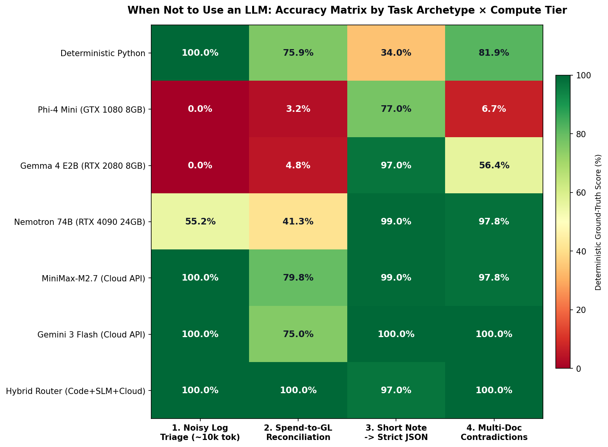
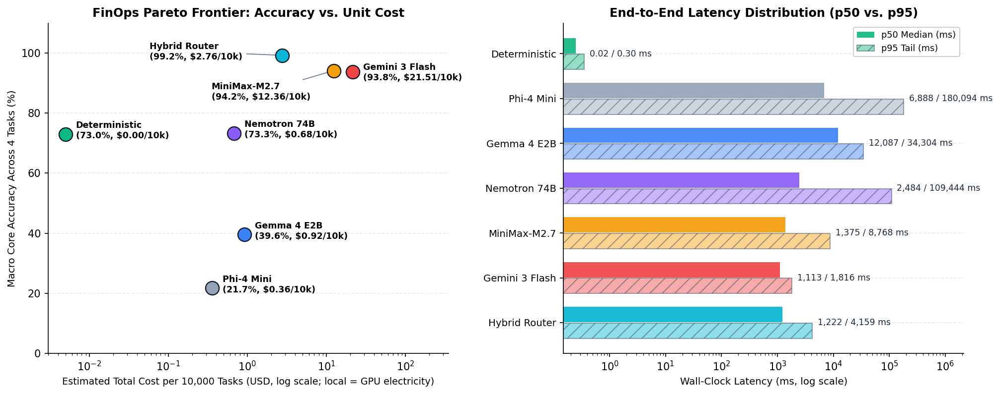
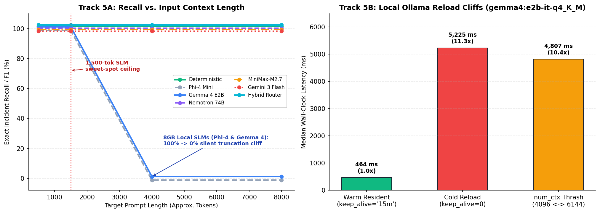

# When *Not* to Use an LLM (`when-not-to-llm`)

[](https://github.com/Benfinkels/when-not-to-llm/actions/workflows/ci.yml)
[](https://www.python.org/downloads/)
[](LICENSE)

Most AI benchmarks compare LLM A against LLM B. Almost none benchmark **Tier -1 (Deterministic Code)** vs. **8GB Local SLMs** vs. **24GB Workstation MoE** vs. **Cloud APIs** vs. **Hybrid Pipelines** on the *same* operational tasks—scored simultaneously on **exact ground-truth accuracy, wall-clock latency, and FinOps cost per 10,000 tasks**.

Across **329 live evaluated runs** (7 compute tiers × 47 deterministic test cases, zero LLM-as-a-Judge):
- **A simple Hybrid Router (`Code + 8GB Local SLM + Cloud`) beat every standalone model** (**`99.2%`** macro accuracy vs. **`94.2%`** MiniMax-M2.7 and **`93.8%`** Gemini 3 Flash) while cutting Cloud API cost by **`-87.2%`** (**`$21.51 -> $2.76` per 10k tasks**) and input tokens by **`-88.1%`**.
- **Every standalone LLM failed exact financial reconciliation (`3.2%–79.8%`):** Even Gemini 3 Flash found `100%` of individual anomalies yet missed the bottom-line ledger variance by **`$8,376–$16,247` on 5/5 reports**. Splitting the job—`Gemma 4 E2B` maps 6 fuzzy vendor names (`~160` tokens) -> Python executes cent-exact math—jumped accuracy to **`100.0%`**.
- **8GB Local SLMs hit a hard step-function cliff past 1,500–4,000 tokens (`100% -> 0%`)**, yet **`Gemma 4 E2B` scored `97.0%`** on short unstructured notes (`<200` tokens) at `$0` API cost—nearly triple deterministic regex (`34.0%`).



---

## Empirical Scorecard (November 2026 Live Hardware + Cloud Run)

Evaluated on 100% seeded synthetic fixtures (`47` cases per tier, `0` subjective grading) across consumer GPUs (`GTX 1080 8GB`, `RTX 2080 8GB`, `RTX 4090 24GB`) and direct Cloud REST APIs (`MiniMax-M2.7`, `Gemini 3 Flash`):

| Compute Tier | 1. Noisy Log Triage (~10k tok) | 2. Spend-to-GL Reconcile | 3. Short Note → JSON (<200 tok) | 4. Multi-Doc Contradictions | **Macro Core Accuracy** | p50 / p95 Latency | **Est. Cost / 10k Tasks** |
| :--- | :---: | :---: | :---: | :---: | :---: | :---: | :---: |
| **Deterministic Python (CPU)** | **100.0%** *(0.3 ms)* | `75.9%` *(0.2 ms)* | `34.0%` *(0.02 ms)* | `81.9%` *(0.3 ms)* | `73.0%` | **0.02 / 0.30 ms** | **`$0.00`** |
| **Phi-4 Mini 3.8B** *(GTX 1080 8GB)* | `0.0%` *(15.7 s)* | `3.2%` *(6.9 s)* | `77.0%` *(2.7 s)* | `6.7%` *(11.5 s)* | `21.7%` | 6.9 / 180.1 s | `$0.36`* |
| **Gemma 4 E2B** *(RTX 2080 8GB)* | `0.0%` *(23.3 s)* | `4.8%` *(22.2 s)* | **`97.0%`** *(1.1 s)* | `56.4%` *(14.1 s)* | `39.6%` | 12.1 / 34.3 s | `$0.92`* |
| **Nemotron 74B-A9B** *(RTX 4090 24GB)* | `55.2%` *(109 s, 2 TO)* | `41.3%` *(2.5 s)* | **`99.0%`** *(0.79 s)* | **`97.8%`** *(5.5 s)* | `73.3%` | 2.5 / 109.4 s | `$0.68`* |
| **MiniMax-M2.7** *(Direct Cloud API)* | **100.0%** *(2.8 s)* | `79.8%` *(8.7 s)* | **`99.0%`** *(0.90 s)* | **`97.8%`** *(4.3 s)* | `94.2%` | 1.4 / 8.8 s | `$12.36` |
| **Gemini 3 Flash** *(Direct Cloud API)* | **100.0%** *(1.7 s)* | `75.0%` *(1.3 s)* | **100.0%** *(0.78 s)* | **100.0%** *(1.8 s)* | `93.8%` | **1.1 / 1.8 s** | `$21.51` |
| **Hybrid Router** *(Code + Gemma 4 + Cloud)* | **100.0%** *(0.4 ms)* | **100.0%** *(3.2 s)* | **`97.0%`** *(2.3 s)* | **100.0%** *(1.8 s)* | **`99.2%`** | 1.2 / 4.2 s | **`$2.76`** |

*\*Local GPU costs reflect marginal electricity (`$0.15/kWh × GPU TDP × measured active wall time`), `$0.00` API fees. Cloud costs apply published list token pricing (`MiniMax-M2.7`: `$0.30/$1.20` per 1M; `Gemini 3 Flash`: `$0.50/$3.00` per 1M) to exact measured token counts.*



---

## Five Empirical Findings

### 1. Never Ask an LLM to Do Exact Financial Arithmetic (Use Hybrid Instead)
Task 2 (`finance_reconcile`) reconciles an 18-row ad platform spend export against an 18-row General Ledger where vendor names are messy (`"GOOG_YT_BRND"` vs `"Alphabet / YouTube Brand Awareness"`, `"TTK_CRTR_US"` vs `"ByteDance TikTok Creator Marketplace"`) and 3 cent-exact anomalies are injected (`variance`, `duplicate_gl`, `missing_gl`).
- **Pure Deterministic Python (`75.9%`):** Cent-accurate arithmetic, but naive token-overlap misses opaque abbreviations.
- **Pure LLMs (`3.2%–79.8%`):** `Nemotron 74B` scored **`41.3%`**. `Gemini 3 Flash` achieved `100%` anomaly recall yet missed the bottom-line `net_variance_usd` by **`$8,376` to `$16,247` on 5/5 cases**.
- **Hybrid (`100.0%`):** Sends **only the 6 unique vendor strings (`~160` tokens)** to `Gemma 4 E2B` to build the canonical mapping, then executes deterministic Python reconciliation. Accuracy jumps from **`4.8%` -> `100.0%`** at `$0` API cost.

### 2. Structured Log & Alert Triage Belongs to Regex, Not GPUs
Task 1 (`log_triage`) buries 5 root-cause `ERROR`/`CRITICAL` signatures inside `~15 KB` (`~10k` BPE tokens) of noisy service logs, with 2 error families exclusively in the first 25% of the log.
- **Deterministic Python:** **`100.0%`** exact signatures & counts in **`0.3 ms`** at **`$0.00`**.
- **8GB Local SLMs (`Phi-4 Mini`, `Gemma 4 E2B`):** **`0.0%`** in `15–23 s` due to default `num_ctx=4096` head-truncation.
- **24GB Workstation (`Nemotron 74B`):** **`55.2%`** (`2/5` timed out at `300 s`, `109 s` median) — `360,000x` slower than regex for a worse answer.

### 3. Small 8GB Local SLMs Have a Hard `~1,500`-Token Sweet Spot — And Actually Win Inside It
- On **Task 3 (`note_to_json`, `<200` tokens)**—parsing informal CRM notes like *"four point two grand"*, *"half-a-grand"*, and implicit follow-up cues—regex collapsed to **`34.0%`**, while **`Gemma 4 E2B` hit `97.0%`** in `1.1 s` at `$0` API cost.
- On **Track 5A (`context_cliff`)**, both `Phi-4 Mini` and `Gemma 4 E2B` scored **`100.0%`** at `500` and `1,500` tokens, then dropped straight to **`0.0%`** at `4,000` and `8,000` tokens when Ollama silently truncated early incidents.

### 4. Local Ollama Infrastructure Cliffs Cause `10–11x` Phantom Latency
Track 5B (`results/infra_cliff.json`) benchmarks two silent configuration pitfalls on `gemma4:e2b-it-q4_K_M` (RTX 2080 8GB):
- **Warm Resident (`keep_alive="15m"`):** **`464 ms`** (`1.0x`)
- **Cold Reload (`OLLAMA_KEEP_ALIVE=0`):** **`5,225 ms`** (**`11.3x` slower** — evicting and reloading weights over PCIe on every request)
- **Varying `num_ctx` across callers (`4096 <-> 6144`):** **`4,807 ms`** (**`10.4x` slower** — forcing KV-cache teardown/reallocation even with `keep_alive="15m"`)



### 5. Multi-Doc Semantic Synthesis Is Where Cloud / 74B Models Earn Their Keep
On **Task 4 (`doc_contradictions`, `~3.1k` tokens across 5 memos)**—spotting subtle contradictions like *"all-inclusive budget cap"* vs. *"retainer billed separately above the cap"*—8GB local SLMs dropped to `6.7%–56.4%`, while `Nemotron 74B` (`97.8%`), `MiniMax-M2.7` (`97.8%`), and `Gemini 3 Flash` (`100.0%`) solved it cleanly.

---

## 1-Page Decision Matrix: Which Tier Should You Reach For?

| Workload Shape | Best Tier | Why |
| :--- | :--- | :--- |
| Structured logs, alerts, exact counts, schema validation | **Deterministic Code** | `100%` recall, `<1 ms`, `$0`, zero context limit. |
| Tables + exact arithmetic + messy/fuzzy string labels | **Hybrid (`SLM map -> Python math`)** | Eliminates LLM arithmetic hallucinations while fixing brittle string joins. |
| Atomic unstructured text (`<1,500` tokens) → JSON/classification | **Warm Local SLM** (`keep_alive="15m"`) | `97%` accuracy at `$0` API cost; keep `num_ctx` fixed across callers. |
| Multi-doc semantic reasoning (`>1,500` tokens) | **Cloud API or 24GB+ Local MoE** | Small SLMs silently truncate or degrade; pay for tokens only here. |

---

## Quick Start

### 1. Run Offline Verification Suite (No GPU or API Keys Required)
```bash
pip install pytest
PYTHONPATH=src pytest -v
```

### 2. Estimate Token & Dollar Cost Before Running Live (`--dry-run`)
```bash
PYTHONPATH=src python -m when_not_to_llm.runner \
  --tiers deterministic gemma4_e2b minimax_m27 gemini_flash hybrid \
  --dry-run
```

### 3. Run Live Tiers (with Checkpoint Resume & Hard Spend Cap)
```bash
# Deterministic baseline only (instant, $0)
PYTHONPATH=src python -m when_not_to_llm.runner --tiers deterministic

# Local Ollama + Cloud APIs (set GEMINI_API_KEY / MINIMAX_API_KEY in env)
PYTHONPATH=src python -m when_not_to_llm.runner \
  --tiers deterministic gemma4_e2b gemini_flash hybrid \
  --gemini-model gemini-3-flash-preview --gemini-rpm 8 \
  --max-cost-usd 1.00 --resume

# Track 5B: Measure local Ollama keep_alive=0 and num_ctx reload cliffs
PYTHONPATH=src python -m when_not_to_llm.infra_cliff \
  --base-url http://127.0.0.1:11434 --model gemma4:e2b-it-q4_K_M --trials 4
```

### 4. Regenerate Charts from Committed Telemetry
```bash
pip install matplotlib numpy
python scripts/generate_charts.py
```

All telemetry in [`results/benchmark_results.json`](results/benchmark_results.json) and [`results/infra_cliff.json`](results/infra_cliff.json) is generated from seeded synthetic fixtures (`src/when_not_to_llm/datasets.py`) and sanitized against private IP / hostname leakage in CI (`tests/test_suite.py`).
